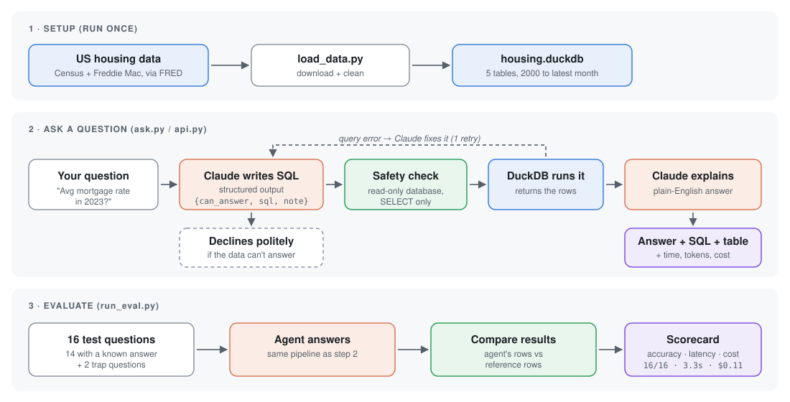

<p align="center">
  
</p>

<h1 align="center">Housing Market SQL Agent</h1>

<p align="center"><em>A portfolio project for the AI Engineer I role at CoStar Group, Glasgow.<br>
Independent work using public data; not affiliated with or endorsed by CoStar Group.</em></p>

<p align="center">
  
</p>

Ask questions about the US new-home market in plain English and get answers backed by real data.
The agent writes SQL with Claude, runs it read-only on DuckDB, retries once if the query fails,
and explains the result. A small eval set measures how often it gets the answer right.

```
> Which region had the highest average new-home sales rate in 2024?

The South led by a wide margin, averaging about 413k units (SAAR) in 2024, roughly 60% of all US new-home sales.

SQL:
SELECT region, avg(units_thousands_saar) AS avg_sales ...
```

## Why this project

CoStar Group's housing analytics help builders and analysts answer questions about new-home sales,
starts, pricing and supply. This is a small version of that idea, built to show the parts of the job that matter in an
AI product: structured LLM outputs, tool use (SQL), guardrails, and measuring quality, latency and cost.

## How it works

The diagram at the top shows the full flow. Key design choices:

- **Structured output**: Claude returns `{can_answer, sql, note}` validated by Pydantic, so there is no regex parsing of SQL out of free text.
- **Self-correction**: if DuckDB rejects the query, the error goes back to Claude for one retry.
- **Guardrails**: the database is opened read-only and only single `SELECT`/`WITH` statements are run.
- **Knows its limits**: questions the data can't answer (a city, a single builder) are declined instead of answered with a made-up number.
- **Grounded schema**: the prompt is generated from the live database, including each table's date range.

## Data

Public data from the US Census Bureau and Freddie Mac via [FRED](https://fred.stlouisfed.org/), 2000 to the latest release:

| Table | Contents | Source series |
|---|---|---|
| `new_home_sales` | Monthly sales by region (SAAR, thousands) | HSN1F, HSN1F{NE,MW,S,W} |
| `housing_starts` | Monthly starts by region (SAAR, thousands) | HOUST, HOUST{NE,MW,S,W} |
| `new_home_median_price` | Median sales price of new homes (USD) | MSPNHSUS |
| `new_home_months_supply` | Months' supply of new homes for sale | MSACSR |
| `mortgage_rates` | Weekly 30-year fixed mortgage rate (%) | MORTGAGE30US |

## Run it

```bash
pip install -r requirements.txt
export ANTHROPIC_API_KEY=...        # PowerShell: $env:ANTHROPIC_API_KEY="..."
python load_data.py                 # downloads data, builds housing.duckdb
python ask.py "How did new-home prices change from 2020 to 2025?"
python ask.py                       # interactive mode
python run_eval.py                  # score the agent
uvicorn api:app                     # optional HTTP API: POST /ask {"question": "..."}
```

The model defaults to `claude-opus-5-5`; set `HOUSING_AGENT_MODEL` to compare others (for example `claude-haiku-5-5`).

## Evaluation

`eval_questions.json` has 16 questions: 14 with a reference SQL query and 2 that the data can't answer.
A question passes when the agent's result matches the reference result (same rows, every reference
column present, numbers within a small tolerance; extra columns are fine). Comparing results instead of
SQL text means any correct query passes. Reference answers are computed live, so they stay correct
when the data is refreshed.

`python run_eval.py --oracle` scores the reference queries themselves (no API calls) to check the harness.

| Model | Accuracy | p50 latency | Cost (16 questions) | Retries used |
|---|---|---|---|---|
| claude-opus-5-5 | 16/16 (100%) | 3.3s (max 6.3s) | $0.11 (~$0.007 per question) | 0 |

Failure types reported: `sql_error`, `wrong_result`, `wrongly_declined`, `should_decline`.

## Limitations and next steps

- National and regional US data only; metro and community-level data like CoStar's would make it far more useful.
- Small eval set. Next step: 50+ questions, including ambiguous ones ("last year", "recently").
- Add a chart output and a retrieval tool over housing reports, so the agent can explain *why* numbers moved, not just *what* they are.
- Cache the schema prompt (prompt caching) to cut cost per question.
